# Seamstress User Guide

Seamstress is a garment creation tool. You draw flat pattern pieces, sew their edges together, place them around
an avatar and let a cloth simulation drape them. The result can be exported as OBJ, glTF or FBX, or sent straight
into MakeHuman's clothes library.

This guide covers everything the application does. If you are coming from Marvelous Designer or CLO, start with
[Getting started](#getting-started) and keep [Coming from Marvelous Designer](#coming-from-marvelous-designer)
open next to it.

**Contents**

1. [Getting started](#getting-started)
2. [The window](#the-window)
3. [Coming from Marvelous Designer](#coming-from-marvelous-designer)
4. [The 2D pattern view](#the-2d-pattern-view)
5. [Sewing](#sewing)
6. [The 3D view](#the-3d-view)
7. [Simulation](#simulation)
8. [Layers](#layers)
9. [Properties](#properties)
10. [Topology: face count, triangles and quads](#topology-face-count-triangles-and-quads)
11. [Materials, UVs and texel density](#materials-uvs-and-texel-density)
12. [Avatars](#avatars)
13. [Saving and the project file](#saving-and-the-project-file)
14. [Exporting](#exporting)
15. [Send to MakeHuman](#send-to-makehuman)
16. [Preferences](#preferences)
17. [Keyboard and mouse reference](#keyboard-and-mouse-reference)
18. [Troubleshooting](#troubleshooting)

---

## Getting started

This walk-through makes a T-shirt in about a minute, using one of the built-in garments so you can see every
stage before drawing your own.

### 1. Add a garment

Choose **Garment ▸ Add T-Shirt**. Four pattern pieces appear in the 2D view on the right, already sewn
together. In the 3D view on the left the same pieces stand flat around the avatar. The red lines between them are
the sewing threads: each one joins two points that will be stitched together.

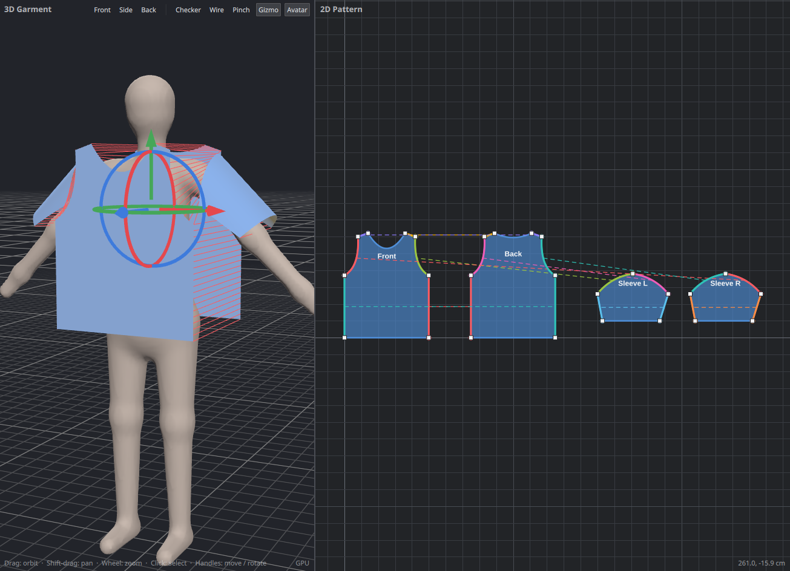

### 2. Simulate

Press **Simulate** (or the Space bar). The pieces are pulled together along their seams, then gravity takes
over and the shirt settles on the body. Press **Simulate** again to stop.

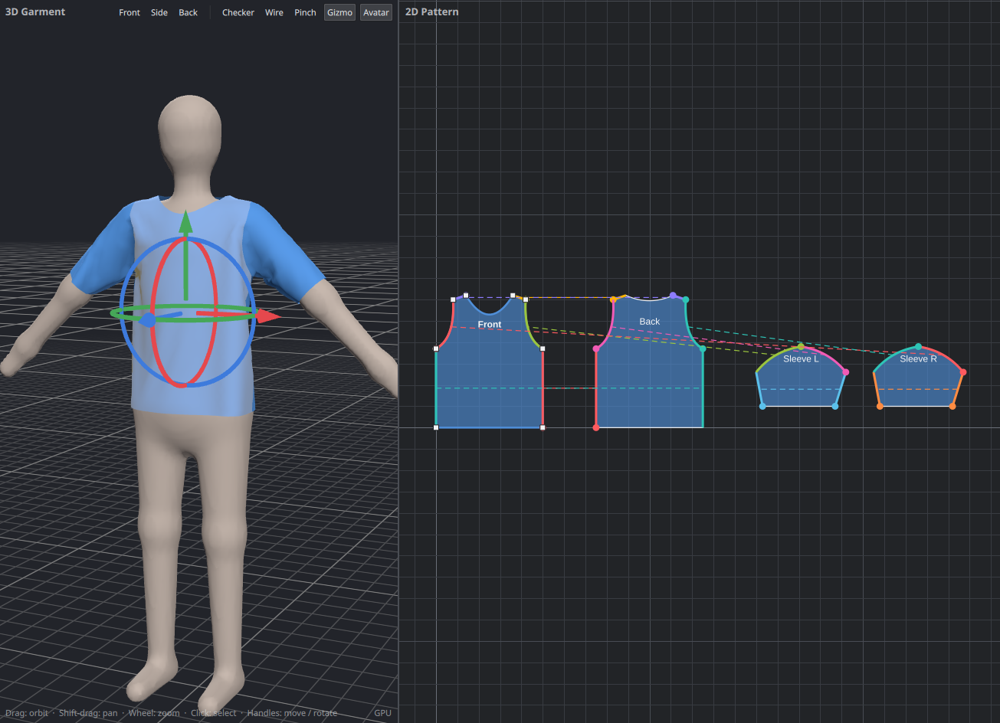

Simulating is one undo step: **Ctrl+Z** puts the pieces back where they were. **Reset** (next to Simulate)
returns them to their flat arrangement at any time.

### 3. Change something and simulate again

- Click a piece in either view to select it. Its settings appear in the **Properties** panel on the right.
- Under **Fabric Physics**, pick another **Preset** (try *Silk* or *Denim*) and simulate again to see the
  difference.
- Under **Topology**, drag **Particle distance** to the left for more faces and finer wrinkles, or to the right
  for fewer.

### 4. Save or export

- **File ▸ Save** writes a `.garment.json` project you can reopen later.
- **File ▸ Export** writes OBJ, glTF or FBX for other applications.

From here, the rest of this guide explains each area in detail, including how to draw and sew your own pieces.

---

## The window

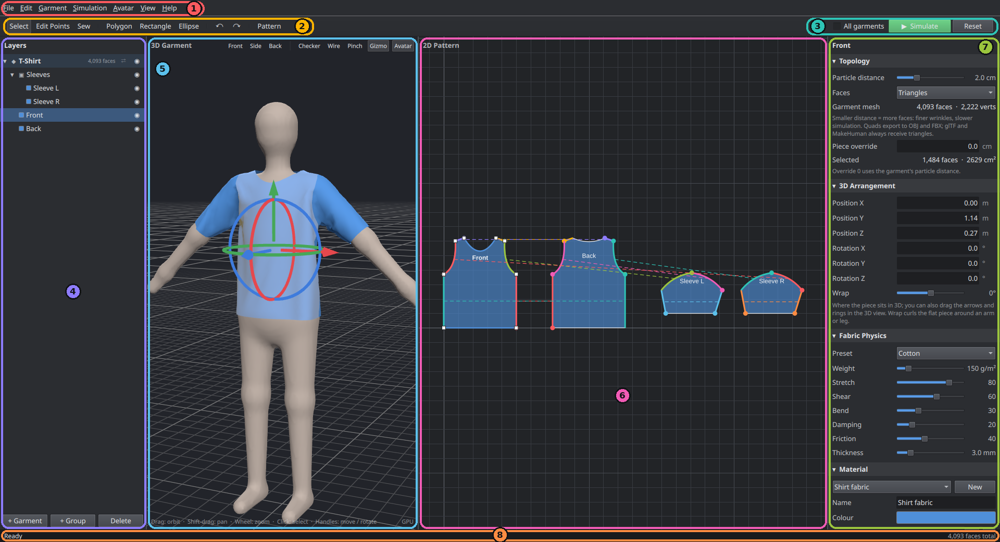

| # | Area | What you do there |
| --- | --- | --- |
| 1 | **Menu bar** | Files, export, edit commands, ready-made garments, avatar choice, view options. |
| 2 | **Tools** | Pick what the mouse does in the 2D view; undo and redo; switch the 2D view between pattern and UV layout. |
| 3 | **Simulation controls** | **Simulate** starts and stops the cloth simulation. **All garments** widens it from the active garment to every visible one. **Reset** returns pieces to their flat arrangement. |
| 4 | **Layers** | Every garment, the groups inside it and its pieces. Select, rename, hide, group, delete. |
| 5 | **3D Garment view** | The avatar and the garments on it. Orbit around, select pieces, move and rotate them with the handles. |
| 6 | **2D Pattern view** | Where pieces are drawn, shaped and sewn. Also shows the UV layout. |
| 7 | **Properties** | Settings of whatever is selected: topology, 3D arrangement, fabric physics, material, UVs, seams, simulation. |
| 8 | **Status bar** | Hints for the current tool, simulation progress, and the total face count. |

The borders between the panels can be dragged to resize them.

### The tools

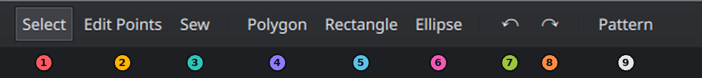

| # | Tool | Key | What it does |
| --- | --- | --- | --- |
| 1 | **Select** | V | Click a piece to select it, drag to move it in the pattern. Ctrl+click adds to the selection. Click a seam's dashed line to select the seam. |
| 2 | **Edit Points** | E | Drag a point to move it. Drag an edge to curve it. Double-click an edge to add a point. |
| 3 | **Sew** | S | Click one edge, then another, to sew them together. |
| 4 | **Polygon** | P | Click to place corners; click the first corner again, double-click, or press Enter to finish. |
| 5 | **Rectangle** | R | Drag out a rectangular piece. |
| 6 | **Ellipse** | O | Drag out an elliptical piece. |
| 7 | Undo | Ctrl+Z | Undo the last change. Hover to see what it will undo. |
| 8 | Redo | Ctrl+Shift+Z | Redo. |
| 9 | **Pattern / UV Layout** | U | Switch the 2D view between the pattern and the UV layout. |

---

## Coming from Marvelous Designer

The workflow is the same: draw patterns in 2D, sew them, arrange them around the avatar, simulate. The table
maps what you already know to where it lives here.

| In Marvelous Designer | In Seamstress |
| --- | --- |
| 2D Pattern window | **2D Pattern view** (right) |
| 3D Garment window | **3D Garment view** (left) |
| Object Browser / Scene | **Layers** panel |
| Property Editor | **Properties** panel |
| Polygon, Rectangle, Ellipse tools | The same three tools, keys **P**, **R**, **O** |
| Transform Pattern | **Select** tool (**V**): drag a piece. Rotate and mirror are in the **Edit** menu |
| Edit Pattern (move points and lines) | **Edit Points** tool (**E**): drag a point |
| Edit Curvature | **Edit Points** tool: drag an edge to bend it |
| Add Point / Split Line | **Edit Points** tool: double-click an edge |
| Segment Sewing | **Sew** tool (**S**): click one edge, then the other |
| Edit Sewing ▸ reverse a twisted seam | Select the seam, then **Reverse Direction** in Properties |
| Simulate (Space) | **Simulate** (Space) |
| Reset 3D Arrangement | **Reset** button, or **Simulation ▸ Reset Arrangement** |
| Gizmo | The arrows and rings on the selected piece in the 3D view |
| Dragging the cloth while simulating | **Pinch** (**G**) in the 3D view; it also works after the simulation has stopped |
| Arrangement points | Not available. Place pieces with the gizmo or the numbers under **3D Arrangement**; **Wrap** curls a piece around an arm or leg |
| Particle Distance | **Topology ▸ Particle distance** (per garment, with a per-piece override) |
| Mesh type: Triangle / Quad | **Topology ▸ Faces**: Triangles or Quads |
| Fabric physical property presets | **Fabric Physics ▸ Preset** |
| Fabric (texture, colour) | **Material** section |
| UV Editor | **Pattern / UV Layout** toggle (**U**) |
| Freeze / deactivate a garment | Not needed: only the *active* garment is simulated. Everything else holds still unless you link it |
| Layers (which garment is on top) | Order of simulation: simulate the inner garment first, then the outer one |
| Avatar | **Avatar** menu: built-in mannequin, MakeHuman base mesh, or your own OBJ |
| Export OBJ / FBX / glTF | **File ▸ Export** |

### Differences to be aware of

- **Garments are separate objects.** A project holds any number of garments (a shirt, a skirt). The one you
  last clicked is the *active* garment, shown highlighted in Layers, and Simulate only affects that one.
- **A seam joins a whole edge to a whole edge.** To sew part of an edge, split it first by double-clicking
  it with the Edit Points tool; each part is then its own edge.
- **Units.** Patterns are in centimetres; 3D positions are in metres.
- **Not available yet:** internal lines and darts, pins, seam allowance, linked symmetric patterns, trims
  (buttons, zippers), pressure and wind, animation, and avatar posing or measurement editing.

---

## The 2D pattern view

The 2D view is where garments are designed. The grid has a line every 10 cm and a stronger line every metre;
the cursor position in centimetres is shown in the bottom-right corner.

**Moving around:** scroll to zoom about the cursor; drag with the middle or right mouse button (or
Alt+left-drag) to pan; press **F** to frame everything.

### Drawing pieces

New pieces go into the active garment. If there is none, one is created.

- **Rectangle** and **Ellipse**: drag from one corner to the opposite corner.
- **Polygon**: click each corner in turn. Finish by clicking the first corner again, double-clicking, or
  pressing **Enter**. **Esc** abandons the shape.

A new piece takes the material and fabric of the garment's first piece, and is placed in front of the avatar's
chest in 3D.

### Shaping pieces

Switch to **Edit Points** (**E**) and click a piece. Its corner points appear as white squares; curved edges
also show a yellow handle.

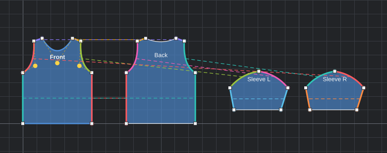

| To                               | Do this                                                               |
| -------------------------------- | --------------------------------------------------------------------- |
| Move a point                     | Drag a white square                                                   |
| Curve an edge                    | Drag anywhere along the edge; the curve follows the cursor            |
| Adjust a curve                   | Drag its yellow handle                                                |
| Add a point                      | Double-click the edge where you want it                               |
| Remove a point                   | Click it, then press **Delete** (a piece keeps at least three points) |
| Make curved edges straight again | **Edit ▸ Straighten Curved Edges**                                    |

### Arranging pieces in the pattern

With the **Select** tool (**V**), drag pieces to lay them out. This only changes the 2D layout (and therefore
the UVs), not the 3D placement. The **Edit** menu also has **Duplicate** (Ctrl+D), **Mirror Piece**, and
**Rotate 90° Left / Right**. Seams stay attached to the right edges when you mirror, add or remove points.

---

## Sewing

Pick the **Sew** tool (**S**), click one edge, then click the edge to sew it to. The first edge stays
highlighted until you click the second; **Esc** cancels. Both edges must belong to the same garment. An edge
may be sewn to an edge of the same piece (the underarm seam of a sleeve, for example).

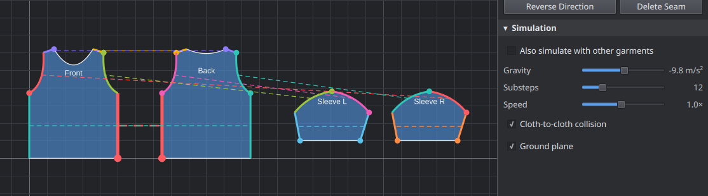

Each seam is drawn with:

- the **two sewn edges in the same colour**,
- a **dashed line** joining them (click it to select the seam),
- a **dot on each edge marking the ends that meet**. If the dots are at opposite ends from what you intended,
  the seam is twisted.

Selecting a seam shows it in Properties:

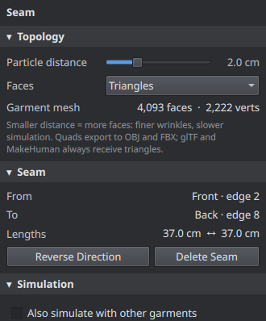

- **From / To** name the two edges and **Lengths** shows how long each is. Edges of different length can be sewn;
  the longer one is eased onto the shorter.
- **Reverse Direction** swaps which ends meet, which fixes a twisted seam.
- **Delete Seam** removes it (so does the **Delete** key).

In the 3D view, seams that are not yet closed appear as red threads between the pieces. They disappear as
simulation pulls each stitch shut.

---

## The 3D view

**Moving around**

| To | Do this |
| --- | --- |
| Orbit | Drag with the left mouse button |
| Pan | Shift+drag, or drag with the middle or right button |
| Zoom | Scroll |
| Select a piece | Click it (Ctrl+click adds to the selection). Click empty space to deselect |

### View buttons

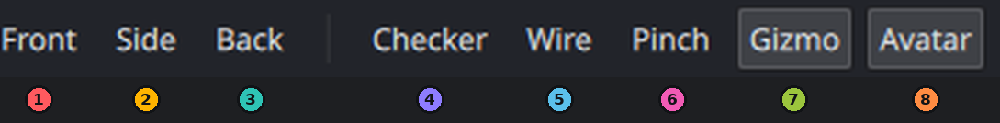

| # | Button | What it does |
| --- | --- | --- |
| 1–3 | **Front / Side / Back** | Jump to a standard camera angle. |
| 4 | **Checker** | Replace fabric colours with a checker texture, to judge UVs and texel density. |
| 5 | **Wire** | Draw the outline of every face, to see the topology. |
| 6 | **Pinch** | Drag the cloth itself to tug it into place (see [Pinching the cloth](#pinching-the-cloth)). |
| 7 | **Gizmo** | Show or hide the move and rotate handles. |
| 8 | **Avatar** | Show or hide the avatar. Hidden, it still collides with the cloth. |

### Moving and rotating pieces

Select one or more pieces and the handles appear at their centre:

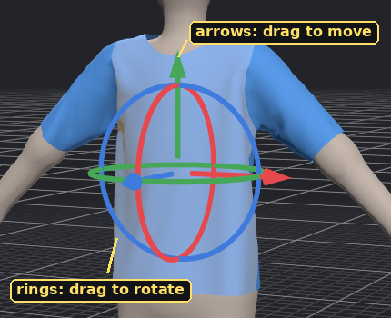

- Drag an **arrow** to slide along that axis (red = X, green = Y/up, blue = Z/front).
- Drag a **ring** to rotate about that axis.

A draped piece keeps its draped shape while you move it, and each drag is one undo step. The same values can be
typed under **3D Arrangement** in Properties; typing a value there returns the piece to its flat shape at the
new position. The handles are hidden while a simulation is running.

### Pinching the cloth

When part of a garment has bunched up, caught on the body, or settled a little off, take hold of it and pull.
Turn on **Pinch** in the 3D view (or press **G**), then press on the cloth and drag: the cloth under the cursor
follows your hand, the fabric around it comes along, and the rest of the garment reacts as it would on a real
body.

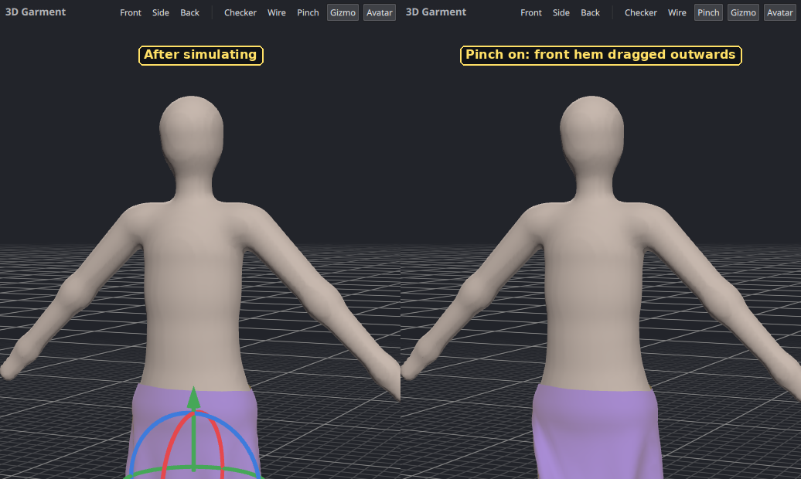

- **During a simulation**, pinching simply adds your hand to it. Let go and the cloth settles from where you
  left it.
- **After a simulation**, pinching starts the simulation for that garment for as long as you hold on, lets the
  cloth settle for a moment after you let go, and stops again. The whole pinch is one undo step (**Ctrl+Z**).
- The cloth still collides with the avatar and other garments, so you can pull it over a shoulder or smooth it
  down against the body, but not drag it through.
- While Pinch is on, dragging on the avatar or on empty space still orbits the camera, Shift+drag pans, and the
  move/rotate handles are hidden. Turn Pinch off to get them back.
- About 5 cm of cloth around the cursor is held; cloth further away is moved only by the fabric pulling on it.
- Only garments that are being simulated can be pinched. If another garment is the active one and a simulation
  is already running, stop it first or tick **All garments**.

---

## Simulation

**Simulate** (Space) runs in two phases, automatically:

1. **Sewing.** Stitched edges are drawn together at a steady pace. Gravity is held back so the pieces do not
   fall off the avatar before they are attached.
2. **Draping.** Once the seams are closed, gravity acts and the cloth settles. It keeps simulating until you
   press **Simulate** again.

The status bar shows the particle count and the time per step while it runs.

### Which garments are simulated

Only the **active garment** — the one selected in Layers — moves. Every other garment stays exactly as it is
and acts as an obstacle. Two ways to widen that:

- Click the **⇄** button on a garment's row in Layers. That garment is then simulated as well whenever another
  garment is the active one.
- Tick **All garments** next to the Simulate button to simulate every visible garment at once.

### Layering garments

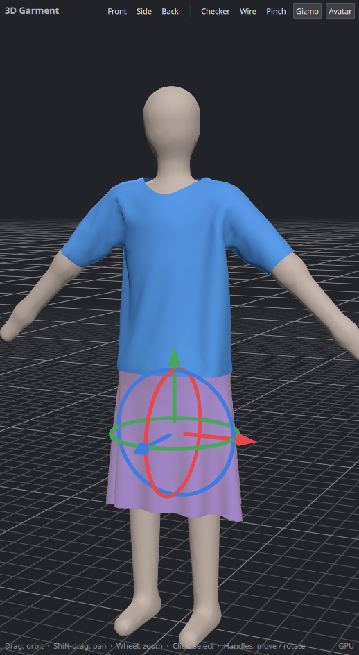

Cloth collides with the avatar, with itself and with other garments. To put one garment over another, simulate
the inner one first (the skirt), then select the outer one (the shirt) and simulate it: the skirt stays put and
the shirt drapes over it. Simulating both together also works when the outer garment starts further from the
body, as the built-in garments do.

### Simulation settings

At the bottom of the Properties panel, under **Simulation**:

| Setting | Meaning |
| --- | --- |
| **Also simulate with other garments** | The same as the ⇄ button in Layers. |
| **Gravity** | Downward acceleration in m/s². |
| **Substeps** | Solver steps per frame. More is stiffer and more accurate, and slower. |
| **Speed** | Slow motion or fast forward. |
| **Cloth-to-cloth collision** | Keeps cloth from passing through itself and other garments. Turning it off roughly halves simulation time. |
| **Ground plane** | Whether cloth stops at the floor. |

### Good to know

- Editing anything while simulating stops the simulation first.
- Changing a piece's outline, its seams or its particle distance returns it to its flat arrangement, because the
  mesh has changed. Simulate again to re-drape.
- A garment that is too small for the body cannot close all its seams; simulation gives up on those after a
  moment and drapes the rest.

---

## Layers

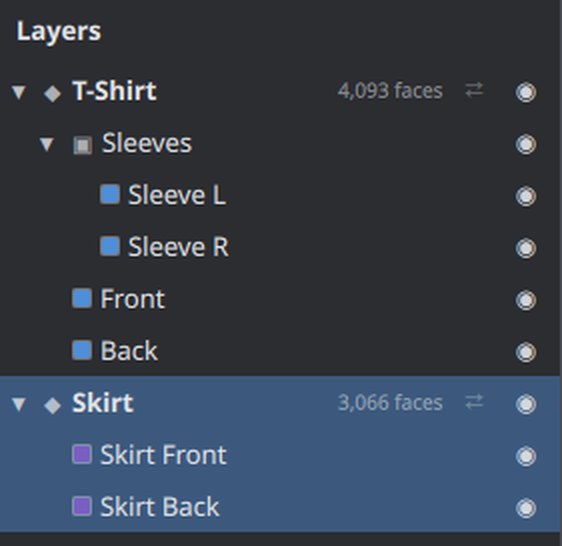

The panel lists garments (◆), the groups inside them (▣) and pieces (coloured squares, in the piece's fabric
colour).

| To | Do this |
| --- | --- |
| Select | Click a row. Clicking a garment or group selects all its pieces. Ctrl+click adds pieces |
| Make a garment active | Click it or any of its pieces |
| Rename | Double-click the name, or right-click ▸ **Rename** |
| Hide or show | Click the circle at the right of the row. Hidden garments are neither simulated nor exported |
| Fold a garment or group | Click the arrow at the left |
| Group pieces | Select them, then **Ctrl+G** or right-click ▸ **Group Selected Pieces** |
| Move into a group | Right-click ▸ **Move to Group**. Groups can be nested |
| Ungroup | Right-click the group ▸ **Ungroup**; its contents move up one level |
| Link for simulation | The **⇄** button on a garment row (see [Simulation](#which-garments-are-simulated)) |
| Add | **+ Garment** and **+ Group** at the bottom |
| Delete | **Delete** at the bottom, the Delete key, or right-click ▸ **Delete** |

Each garment row also shows its face count.

---

## Properties

The panel shows sections for the current selection. Click a section title to fold it. Sliders and number boxes
apply immediately; dragging a slider counts as a single undo step.

### 3D Arrangement and Fabric Physics

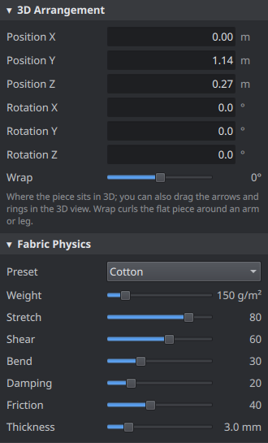

**3D Arrangement** — where the flat piece starts before simulation.

| Setting | Meaning |
| --- | --- |
| **Position X / Y / Z** | Centre of the piece in metres. X is left–right, Y is up, Z is front–back (positive is in front of the avatar). |
| **Rotation X / Y / Z** | Orientation in degrees. A back piece is typically rotated 180° about Y so it faces away. |
| **Wrap** | Curls the piece around its vertical axis by this many degrees, for sleeves and trouser legs. |

**Fabric Physics** — per piece, so one garment can mix fabrics.

| Setting | Meaning |
| --- | --- |
| **Preset** | Cotton, Silk, Jersey Knit, Denim, Leather, Wool or Chiffon. Changing any slider afterwards shows *Custom*. |
| **Weight** | Grams per square metre. Heavier cloth hangs straighter. |
| **Stretch** | Resistance to stretching along the weave (0–100). |
| **Shear** | Resistance to diagonal distortion (0–100). |
| **Bend** | Resistance to folding. Low values give many small wrinkles; high values give stiff, smooth cloth. |
| **Damping** | How quickly motion dies out. |
| **Friction** | Grip against the avatar and other cloth. |
| **Thickness** | Collision thickness in millimetres: how far the cloth sits off the body and other layers. |

With several pieces selected, a change applies to all of them.

---

## Topology: face count, triangles and quads

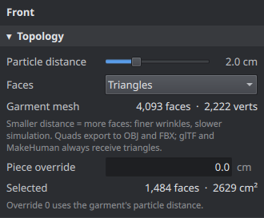

- **Particle distance** is the target edge length of the mesh, per garment. Smaller means more faces: finer
  wrinkles and slower simulation. The face and vertex counts update as you drag.
- **Faces** chooses **Triangles** (even, near-equilateral) or **Quads** (a grid along the fabric grain).
- **Piece override** gives the selected piece its own particle distance; 0 means "use the garment's".

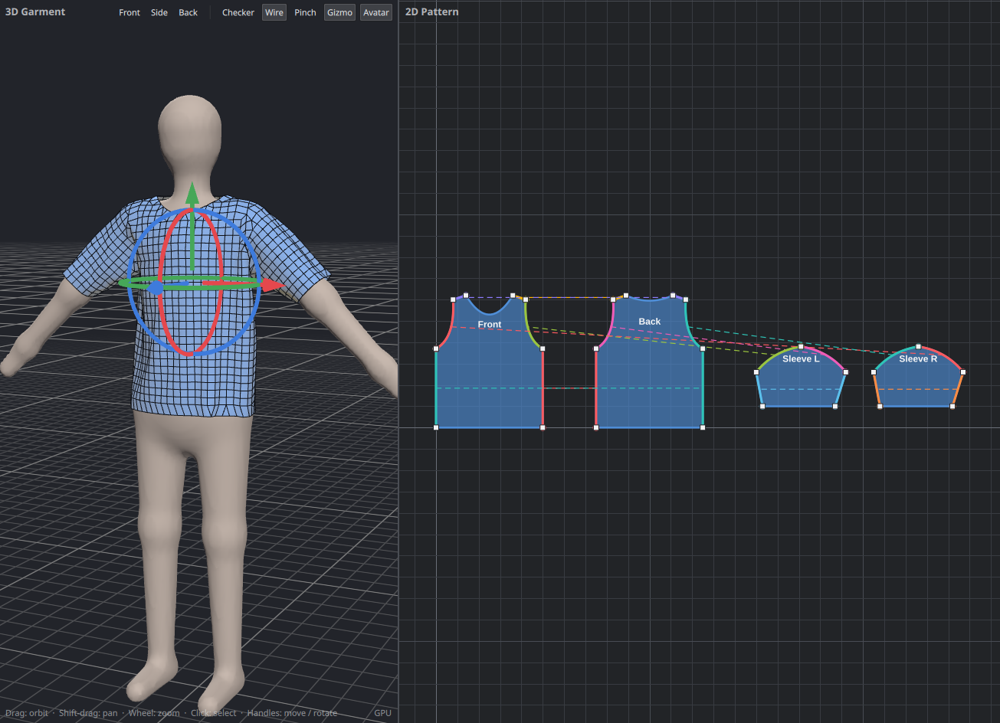

Turn on **Wire** in the 3D view to see the result. Quad topology is quad-dominant: the grid fills each piece
and a few triangles remain where the outline is curved or slanted. The panel shows how many of each. Quads are
written to OBJ and FBX; glTF and MakeHuman always receive triangles, because those formats require it.

Sewn edges always get the same number of segments on both sides, so seams line up vertex for vertex.

---

## Materials, UVs and texel density

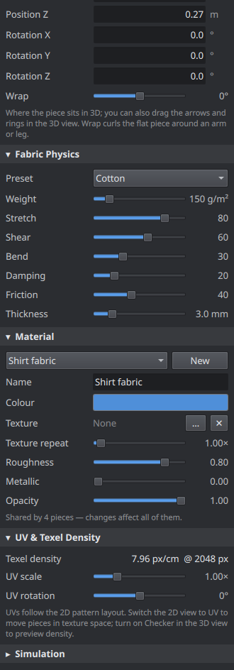

### Material

Each piece uses one material; pieces can share one.

| Setting | Meaning |
| --- | --- |
| Drop-down | Assign another existing material to the selected pieces. |
| **New** | Give the selected pieces their own copy of the current material. |
| **Name** | Used for the material in exported files. |
| **Colour** | Click the swatch to pick a colour. |
| **Texture** | **…** chooses an image (PNG, JPEG, WebP, BMP); **✕** removes it. |
| **Texture repeat** | How many times the image tiles across the UV square. |
| **Roughness / Metallic / Opacity** | Surface appearance, also written to glTF and FBX. |

A note under the sliders tells you when a material is shared, since changes then affect every piece using it.

### UVs

UVs come from the 2D pattern: the garment's layout is scaled evenly into the unit square, so every piece gets
the same texel density and the fabric grain follows the pattern.

Press **U** (or the **Pattern** button) to see the UV layout of the active garment, and switch on **Checker**
in the 3D view to see how a texture will sit on the cloth:

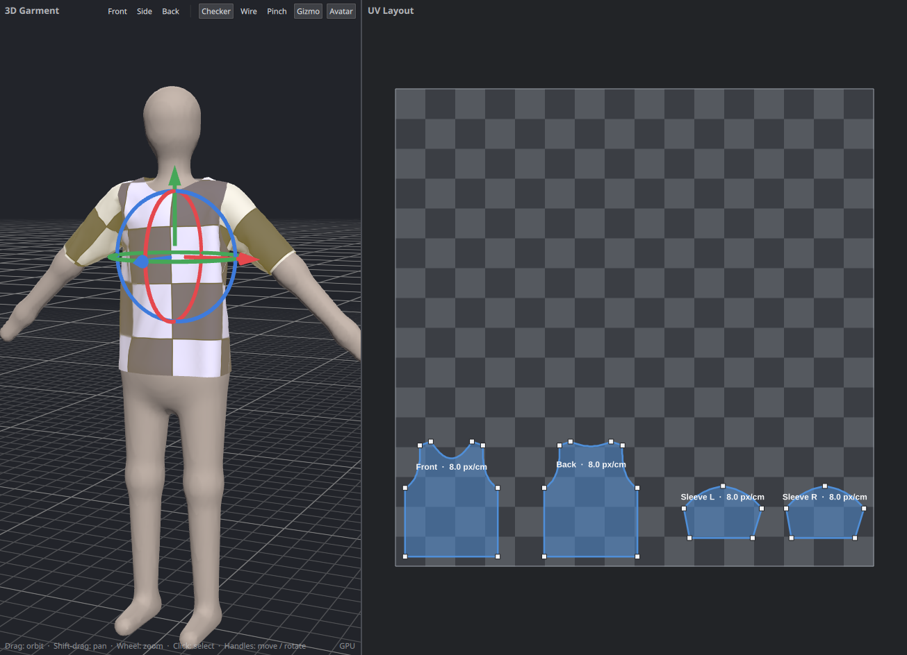

- In the UV layout, drag a piece to move it in texture space.
- **UV scale** and **UV rotation** in Properties adjust the selected piece about its centre.
- **Texel density** reports texture pixels per centimetre of fabric for the selected piece, for the texture
  size set in Preferences. The UV view shows the same figure on every piece.

---

## Avatars

The **Avatar** menu chooses what garments are draped on:

| Choice | Use it for |
| --- | --- |
| **Mannequin** | The built-in figure, about 1.67 m tall. It has the proportions of the MakeHuman base mesh. |
| **MakeHuman Base Mesh** | Making clothes for MakeHuman characters. Requires the base mesh to be linked in Preferences. Starts as MakeHuman's neutral default character. |
| **MakeHuman Body Shape…** | Change that character's gender, age, muscle, weight, height and proportions (see below). |
| **Load OBJ…** | Your own character. The OBJ must be in metres, Y up, facing +Z; it is stood on the ground automatically. |
| **None** | Simulating cloth with nothing to collide with but the ground. |

Loading an avatar takes a second or two while its collision data is prepared. If you press Simulate during
that time, simulation starts as soon as the avatar is ready.

### MakeHuman body shape

With the MakeHuman avatar selected, **Avatar ▸ MakeHuman Body Shape…** opens the same sliders as the *Main*
tab of MakeHuman's Modelling page:

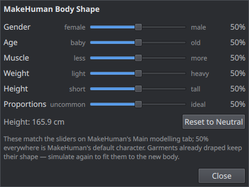

Every slider at 50 % is MakeHuman's default character, and the body matches what MakeHuman shows for the same
values (the default is 165.9 cm tall in both). The avatar is rebuilt when you let go of a slider. The dialog can
stay open while you work, and the settings are saved with the project.

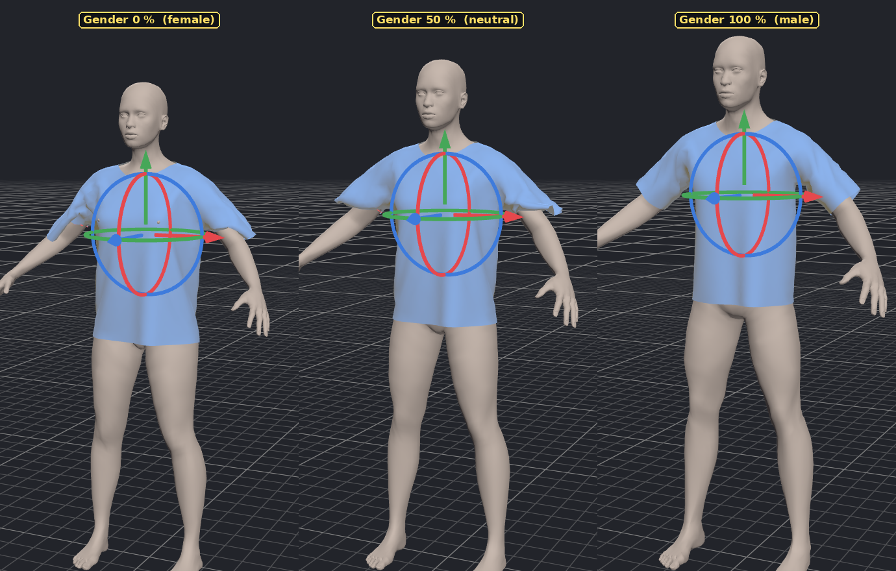

- Garments that are already draped keep their shape when the body changes. Simulate again to fit them.
- The built-in garments are placed at the shoulders, arms and hips of whatever body is current when you add
  them. They are one size, cut for an average adult: on a much larger, smaller or heavier body, resize the
  pattern pieces.
- The sliders need MakeHuman's `data/targets` folder next to the base mesh's `data/3dobjs` folder, which is
  where a normal MakeHuman installation keeps it. Without it the avatar is the unmodified base mesh file,
  which is MakeHuman's average woman.
- Ethnicity is fixed at MakeHuman's default even mix, and the detail sliders on MakeHuman's other tabs (face,
  torso, arms and legs, breast shape) are not available here.

---

## Saving and the project file

**File ▸ Save** (Ctrl+S) and **Save As** (Ctrl+Shift+S) write a `.garment.json` file containing every
garment, seam, material, the avatar choice, simulation settings, and the draped shape. **File ▸ Open Recent**
lists the last ten projects. A dot in the window title marks unsaved changes.

The file is plain JSON meant to be readable and editable by hand:

```json
{
  "format": "seamstress-garment",
  "garments": [
    { "name": "Scarf",
      "particleDistance": 2,
      "topology": "triangles",
      "pieces": [
        { "name": "Strip",
          "points": [ { "at": [0, 0] }, { "at": [120, 0] }, { "at": [120, 20] }, { "at": [0, 20], "curve": [-5, 10] } ] }
      ] }
  ]
}
```

- Pattern lengths are centimetres; 3D positions are metres; angles are degrees.
- `curve` is the control point that bends the edge leaving that point.
- A seam's `edge` number *n* means the edge that starts at point *n* of the piece, counting from 0.
- Anything left out takes its default, so a minimal file like the one above loads.
- The `drape` block holds the simulated shape. Deleting it returns the piece to its flat arrangement.
- Texture paths are stored relative to the project file when the image is in the same folder or below it.

A complete example is in [`samples/tshirt-and-skirt.garment.json`](../samples/tshirt-and-skirt.garment.json).

---

## Exporting

**File ▸ Export** offers three formats. Each first asks two questions:

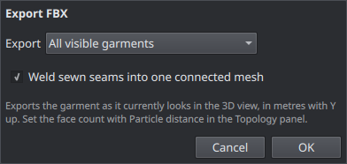

- **Export**: all visible garments, or only the active one.
- **Weld sewn seams**: merge the stitched vertices so each garment is one connected mesh. Only seams that
  simulation has actually closed are merged, so an unsimulated garment exports as separate flat pieces.

| Format | Notes |
| --- | --- |
| **Wavefront OBJ** | `.obj` plus `.mtl`. One object per garment, one group per piece. Keeps quads. |
| **glTF 2.0** | `.glb` (single file, textures embedded) or `.gltf` + `.bin`, chosen by the file name. Triangles only. |
| **FBX** | Binary FBX 7.4. Geometry, normals, UVs and materials; no skeleton or animation. Keeps quads. |

All formats export the garment as it currently looks in the 3D view, with Y up. OBJ and glTF are in metres; FBX
is in centimetres, which is that format's convention, so it imports at the right size. Textures are copied next
to the exported file (or embedded, for `.glb`). Hidden garments and pieces are left out.

---

## Send to MakeHuman

Seamstress can write a garment directly into MakeHuman's clothes library, fitted so that it follows the
character when its body shape changes.

1. Link MakeHuman once in [Preferences](#preferences).
2. Choose **Avatar ▸ MakeHuman Base Mesh**, and optionally set its body with **MakeHuman Body Shape…**.
3. Build the garment and simulate it on that avatar.
4. Select the garment and choose **File ▸ Export ▸ Send to MakeHuman**.

This writes `<name>.mhclo`, `<name>.obj` and `<name>.mhmat` (plus the texture, if any) into
`<MakeHuman user folder>/data/clothes/<name>/`. In MakeHuman the garment appears under
**Geometries ▸ Clothes**; restart MakeHuman if it was already running. Sending a garment with the same name
again replaces the earlier one.

Seamstress refuses to send while a different avatar is in use, because the garment would not be fitted to
MakeHuman's body.

---

## Preferences

**File ▸ Preferences…**

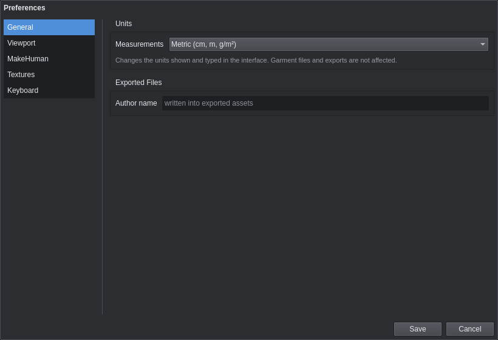

| Setting | Meaning |
| --- | --- |
| **User data folder** | MakeHuman's own data folder, the one containing `data/clothes` (for example `~/makehuman/v1py3`). |
| **Base mesh** | MakeHuman's `base.obj`, found in its `data/3dobjs` folder. |
| **Launch command** | Optional. If set, MakeHuman is started after *Send to MakeHuman* when it is not already running. |
| **Author name** | Written into exported MakeHuman assets. |
| **Detect Automatically** | Looks for MakeHuman in the usual places and fills in the two paths. |
| **Renderer** | *Automatic* uses the GPU and falls back to CPU rendering when no GPU driver is found or the GPU failed to start last time. *GPU* and *CPU* force one or the other. Takes effect on the next start. |
| **Texture size for texel density** | The texture resolution assumed by the texel density read-outs. |

The renderer in use is shown in the bottom-right corner of the 3D view. You can also force it for one run by
starting Seamstress with `--cpu` or `--gpu`.

---

## Keyboard and mouse reference

### Keys

| Key | Action |
| --- | --- |
| V / E / S | Select / Edit Points / Sew |
| P / R / O | Polygon / Rectangle / Ellipse |
| U | Switch the 2D view between pattern and UV layout |
| F | Frame everything in the 2D view |
| G | Turn Pinch on or off in the 3D view |
| Space | Start or stop simulation |
| Enter | Finish the polygon being drawn |
| Esc | Cancel the current tool action |
| Delete / Backspace | Delete the selected pieces, seam or point |
| Ctrl+Z | Undo |
| Ctrl+Shift+Z or Ctrl+Y | Redo |
| Ctrl+D | Duplicate the selected pieces |
| Ctrl+G | Group the selected pieces |
| Ctrl+A | Select every piece of the active garment |
| Ctrl+N / Ctrl+O | New project / open |
| Ctrl+S / Ctrl+Shift+S | Save / save as |

### Mouse

| | 2D view | 3D view |
| --- | --- | --- |
| Left button | The current tool | Drag to orbit; click to select; drag a handle to move or rotate; with Pinch on, drag the cloth to pull it |
| Ctrl or Shift + click | Add to the selection | Add to the selection |
| Shift + drag | — | Pan |
| Middle or right drag | Pan | Pan |
| Alt + left drag | Pan | — |
| Scroll | Zoom about the cursor | Zoom |
| Double-click | Finish a polygon; add a point (Edit Points) | — |

---

## Troubleshooting

**A seam twists the cloth into a knot.** The two edges are sewn end-to-wrong-end. Select the seam (click its
dashed line with the Select tool) and press **Reverse Direction**. The dots on the two edges show which ends
meet.

**The pieces fall off or end up on the wrong side of the body.** Check the 3D arrangement before simulating:
a front piece should stand in front of the avatar and a back piece behind it, facing away (rotated 180° about
Y). Sleeves need **Wrap** so they start curled around the arm. Press **Reset**, move the pieces with the
handles, and simulate again.

**Some seams never close.** The garment is too small to go around the body there. Widen the pieces, or check
that an arm or leg is not caught between two pieces that are meant to meet.

**The cloth is bunched up or caught somewhere after simulating.** Turn on **Pinch** (**G**) in the 3D view and
drag that part of the cloth to where it should sit.

**Simulation is slow.** Raise **Particle distance** (fewer faces), lower **Substeps**, or switch off
**Cloth-to-cloth collision** while blocking out the garment and turn it back on for the final drape.

**One garment hangs through another.** Simulate the inner garment first, then the outer one, with
**Cloth-to-cloth collision** on. Two loose hems at the same height can still slip past each other.

**A texture shows as missing.** The image file was moved. Choose it again with **…** in the Material section.

**The 3D view is blank or the application will not start.** Start it with `--cpu` to use CPU rendering, or
choose *CPU* under **Preferences ▸ Renderer**.

---

*The screenshots in this guide were taken from the application itself. `docs/tools/annotate.py` crops and
numbers them; see the comments at the top of that file.*
