# Seamstress User Guide

Seamstress is a garment creation tool. You draw flat pattern pieces, sew their edges together, place them around
an avatar and let a cloth simulation drape them. The result can be exported as OBJ, glTF or FBX, or sent straight
into MakeHuman's clothes library.

This guide covers everything the application does. If you are coming from Marvelous Designer or CLO, start with
[Getting started](#getting-started) and keep [Coming from Marvelous Designer](#coming-from-marvelous-designer)
open next to it.

**Contents**

1. [Getting started](#getting-started)
2. [The window](#the-window)
3. [Coming from Marvelous Designer](#coming-from-marvelous-designer)
4. [The 2D pattern view](#the-2d-pattern-view)
5. [Sewing](#sewing)
6. [The 3D view](#the-3d-view)
7. [Simulation](#simulation)
8. [Layers](#layers)
9. [Properties](#properties)
10. [Topology: face count, triangles and quads](#topology-face-count-triangles-and-quads)
11. [Materials, UVs and texel density](#materials-uvs-and-texel-density)
12. [Avatars](#avatars)
13. [Saving and the project file](#saving-and-the-project-file)
14. [Exporting](#exporting)
15. [Send to MakeHuman](#send-to-makehuman)
16. [Preferences](#preferences)
17. [Keyboard and mouse reference](#keyboard-and-mouse-reference)
18. [Troubleshooting](#troubleshooting)

---

## Getting started

This walk-through makes a T-shirt in about a minute, using one of the built-in garments so you can see every
stage before drawing your own.

### 1. Add a garment

Choose **Garment ▸ Add T-Shirt**. Four pattern pieces appear in the 2D view on the right, already sewn
together. In the 3D view on the left the same pieces stand flat around the avatar. The red lines between them are
the sewing threads: each one joins two points that will be stitched together.


### 2. Simulate

Press **Simulate** (or the Space bar). The pieces are pulled together along their seams, then gravity takes
over and the shirt settles on the body. Press **Simulate** again to stop.


Simulating is one undo step: **Ctrl+Z** puts the pieces back where they were. **Reset** (next to Simulate)
returns them to their flat arrangement at any time.

### 3. Change something and simulate again

- Click a piece in either view to select it. Its settings appear in the **Properties** panel on the right.
- Under **Fabric Physics**, pick another **Preset** (try *Silk* or *Denim*) and simulate again to see the
  difference.
- Under **Topology**, drag **Particle distance** to the left for more faces and finer wrinkles, or to the right
  for fewer.

### 4. Save or export

- **File ▸ Save** writes a `.garment.json` project you can reopen later.
- **File ▸ Export** writes OBJ, glTF or FBX for other applications.

From here, the rest of this guide explains each area in detail, including how to draw and sew your own pieces.

---

## The window


| # | Area | What you do there |
| --- | --- | --- |
| 1 | **Menu bar** | Files, export, edit commands, ready-made garments, avatar choice, view options. |
| 2 | **Tools** | Pick what the mouse does in the 2D view; undo and redo; switch the 2D view between pattern and UV layout. |
| 3 | **Simulation controls** | **Simulate** starts and stops the cloth simulation. **All garments** widens it from the active garment to every visible one. **Reset** returns pieces to their flat arrangement. |
| 4 | **Layers** | Every garment, the groups inside it and its pieces. Select, rename, hide, group, delete. |
| 5 | **3D Garment view** | The avatar and the garments on it. Ctrl-drag to orbit around, select pieces, move and rotate them with the handles. |
| 6 | **2D Pattern view** | Where pieces are drawn, shaped and sewn. Also shows the UV layout. |
| 7 | **Properties** | Settings of whatever is selected: topology, 3D arrangement, fabric physics, material, UVs, seams, simulation. |
| 8 | **Status bar** | Hints for the current tool, simulation progress, and the total face count. |

The borders between the panels can be dragged to resize them.

### The tools


| # | Tool | Key | What it does |
| --- | --- | --- | --- |
| 1 | **Select** | V | Click a piece to select it, drag to move it in the pattern. Ctrl+click adds to the selection. Click a seam's dashed line to select the seam. Double-click a piece to select all its points. |
| 2 | **Edit Points** | A | Drag a point to move it. Drag an edge to curve it. Double-click an edge to add a point. |
| 3 | **Transform Points** | T | Select one point or several, then move or rotate them with handles. Does not bend edges. |
| 4 | **Sew** | S | Click one edge, then another, to sew them together. |
| 5 | **Polygon** | P | Click to place corners; click the first corner again, double-click, or press Enter to finish. |
| 6 | **Rectangle** | B | Drag out a rectangular piece. |
| 7 | **Ellipse** | O | Drag out an elliptical piece. |
| 8 | **Ruler** | M | Measure a distance in the 2D view, or between two points on the cloth or avatar in the 3D view (see [Measuring with the Ruler](#measuring-with-the-ruler)). |
| 9 | Undo | Ctrl+Z | Undo the last change. Hover to see what it will undo. |
| 10 | Redo | Ctrl+Shift+Z | Redo. |
| 11 | **Pattern / UV Layout** | U | Switch the 2D view between the pattern and the UV layout. |

The keys are the defaults; every one of them can be changed in [Preferences ▸ Keyboard](#keyboard-shortcuts).

**Right-click** in the 2D or 3D view opens the **Edit** menu, with each command's key on the right. The piece
under the pointer is selected first, unless it is already part of the selection, so the menu acts on what you
clicked. Dragging with the right button still pans.

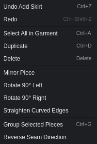

---

## Coming from Marvelous Designer

The workflow is the same: draw patterns in 2D, sew them, arrange them around the avatar, simulate. The table
maps what you already know to where it lives here.

| In Marvelous Designer | In Seamstress |
| --- | --- |
| 2D Pattern window | **2D Pattern view** (right) |
| 3D Garment window | **3D Garment view** (left) |
| Object Browser / Scene | **Layers** panel |
| Property Editor | **Properties** panel |
| Polygon, Rectangle, Ellipse tools | The same three tools, keys **P**, **B**, **O** |
| Transform Pattern | **Select** tool (**V**): drag a piece. Rotate and mirror are in the **Edit** menu |
| Edit Pattern (move points and lines) | **Edit Points** tool (**A**): drag a point |
| Selecting several points and moving or rotating them | **Transform Points** tool (**T**) |
| Edit Curvature | **Edit Points** tool: drag an edge to bend it |
| Add Point / Split Line | **Edit Points** tool: double-click an edge |
| Internal shape ▸ Cut / Convert to Hole | Draw the shape as a piece on top, select both, **Edit ▸ Cut Hole** |
| Segment Sewing | **Sew** tool (**S**): click one edge, then the other |
| Edit Sewing ▸ reverse a twisted seam | Select the seam, then **Reverse Direction** in Properties |
| Simulate (Space) | **Simulate** (Space) |
| Reset 3D Arrangement | **Reset** button, or **Simulation ▸ Reset Arrangement** |
| Gizmo | The arrows and rings on the selected piece in the 3D view |
| Dragging the cloth while simulating | **Pinch** (**G**) in the 3D view; it also works after the simulation has stopped |
| Arrangement points | Not available. Place pieces with the gizmo or the numbers under **3D Arrangement**; **Wrap** curls a piece around an arm or leg |
| Particle Distance | **Topology ▸ Particle distance** (per garment, with a per-piece override) |
| Mesh type: Triangle / Quad | **Topology ▸ Faces**: Triangles or Quads |
| Fabric physical property presets | **Fabric Physics ▸ Preset** |
| Fabric (texture, colour) | **Material** section |
| UV Editor | **Pattern / UV Layout** toggle (**U**) |
| Freeze / deactivate a garment | Not needed: only the *active* garment is simulated. Everything else holds still unless you link it |
| Layers (which garment is on top) | Order of simulation: simulate the inner garment first, then the outer one |
| Avatar | **Avatar** menu: built-in mannequin, MakeHuman base mesh, or your own OBJ |
| Export OBJ / FBX / glTF | **File ▸ Export** |

### Differences to be aware of

- **Garments are separate objects.** A project holds any number of garments (a shirt, a skirt). The one you
  last clicked is the *active* garment, shown highlighted in Layers, and Simulate only affects that one.
- **A seam joins a whole edge to a whole edge.** To sew part of an edge, split it first by double-clicking
  it with the Edit Points tool; each part is then its own edge.
- **Units.** Patterns are in centimetres; 3D positions are in metres. To work in inches instead, switch
  **Measurements** to Imperial in [Preferences](#preferences).
- **Not available yet:** internal lines and darts, seam allowance, linked symmetric patterns, trims
  (buttons, zippers), pressure and wind, animation, and avatar posing or measurement editing.

---

## The 2D pattern view

The 2D view is where garments are designed. The cursor position is shown in the bottom-right corner.

**The grid** gets finer as you zoom in. The scale bar in the bottom-left corner is the width of one grid
square and says how big it is: 1 mm, 1 cm, 10 cm, 1 m or 10 m in metric, and 1/8 in, 1 in, 4 in, 1 ft or 1 yd
in imperial. Every few squares there is a stronger line (every tenth square in metric).

**Moving around:** scroll to zoom about the cursor; drag with the middle or right mouse button (or
Alt+left-drag) to pan; press **F** to frame everything. A right-click without dragging opens the Edit menu.

**The body** is drawn faintly behind the pieces: a front view of the same avatar you see in 3D (the mannequin
or a MakeHuman mesh), at its true size, standing on the origin, so you can see where the pattern falls on the
body without the body getting in the way. It follows the avatar: switching base mesh under **Avatar** or
changing the body shape redraws it. **View ▸ 2D: Show Avatar** turns it off and on.

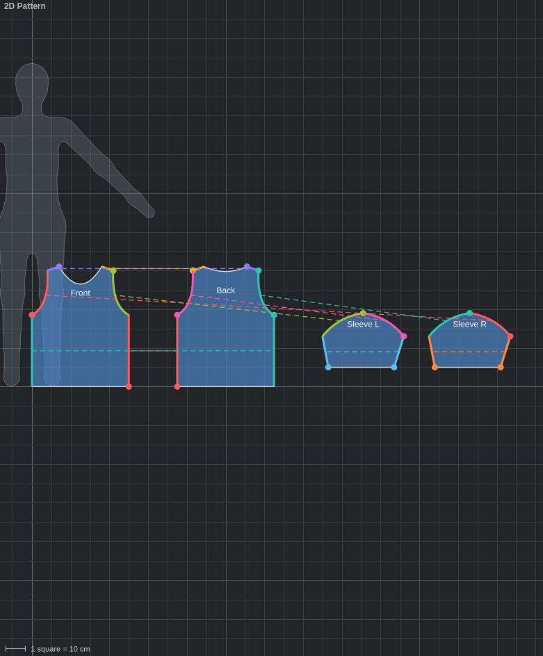

### Drawing pieces

New pieces go into the active garment. If there is none, one is created.

- **Rectangle** and **Ellipse**: drag from one corner to the opposite corner. Hold **Shift** for a square or
  a circle.
- **Polygon**: click each corner in turn. Finish by clicking the first corner again, double-clicking, or
  pressing **Enter**. **Esc** abandons the shape. Hold **Shift** to constrain the side you are placing: its
  angle snaps to 15° steps and its length to a whole centimetre (or quarter inch). Shift applies side by
  side, so you can hold it for one side and let go for the next.

While you draw, each side shows its length; a rectangle shows its width and height and an ellipse its size
across. Shift can be pressed or released in the middle of a drag.

### Moving, rotating and scaling pieces in 2D

With the **Select** tool, a selected piece shows the same handles as the 3D view (see
[Choosing which handles are shown](#choosing-which-handles-are-shown)). The arrows move the piece along one
axis, the ring turns it, and the boxes scale it: red for width, green for height, yellow for both. Hold
**Shift** while turning for 15° steps and while scaling for steps of a tenth. You can still drag the piece
itself to move it freely.

### Measuring edges

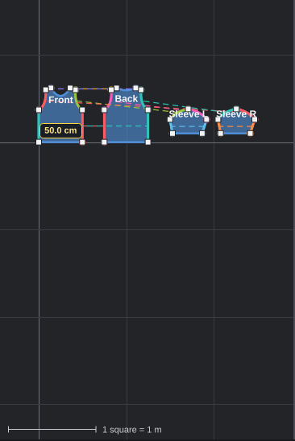

Click an edge with the **Select** or **Edit Points** tool to see how long it is, straight or curved, in the
units chosen in Preferences. Clicking a little outside the piece is close enough. The label follows the edge
while you bend it, and dragging a point shows the two edges that meet there. With the **Sew** tool the edge
under the cursor and the first edge you picked show their lengths, and a selected seam shows both of its
edges, which makes it easy to see whether the two sides match.

A new piece takes the material and fabric of the garment's first piece, and is placed in front of the avatar's
chest in 3D.

### Measuring with the Ruler

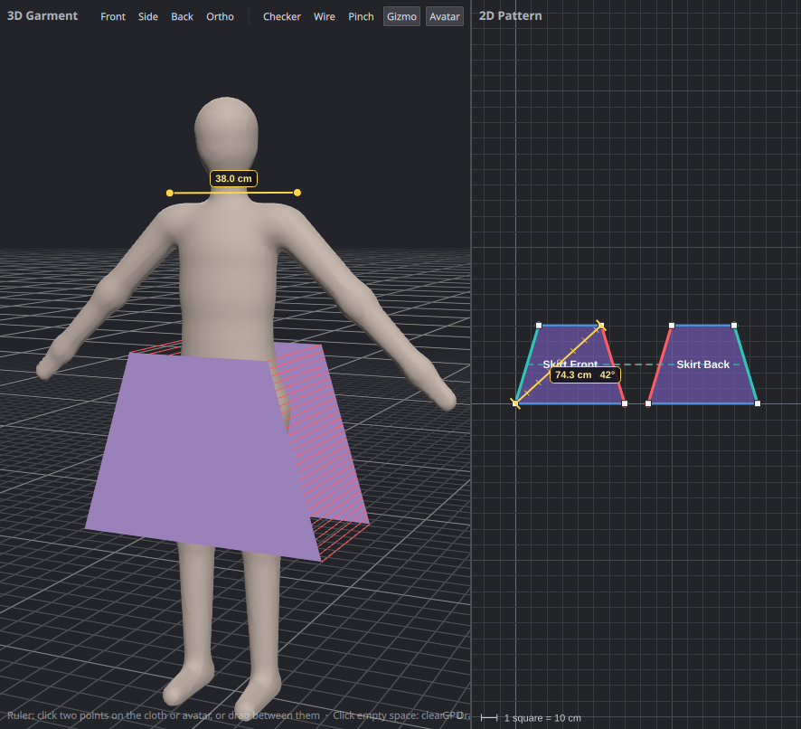

Pick the **Ruler** (**M**).

- **In the 2D view**, drag from one place to another. The line shows a tick at every grid square, and the label
  gives the distance and its angle. An end that comes near a pattern point catches on it, so measuring from
  corner to corner is exact. Hold **Shift** to keep the line to 15° steps.
- **In the 3D view**, click a point on the cloth or the avatar, then click a second one; the far end follows the
  pointer until you do. You can also drag from the first point to the second. The distance is straight across,
  not along the surface. Ctrl+dragging from empty space still orbits the camera.

The ruler stays until you measure again, click empty space, press **Esc**, or pick another tool. It never
changes the pattern.

### Shaping pieces

Switch to **Edit Points** (**A**) and click a piece. Its corner points appear as white squares; curved edges
also show a yellow handle.


| To                               | Do this                                                               |
| -------------------------------- | --------------------------------------------------------------------- |
| Move a point                     | Drag a white square                                                   |
| Put a point on the grid          | Hold **Shift** while dragging it (or its yellow handle)               |
| Curve an edge                    | Drag anywhere along the edge; the curve follows the cursor            |
| Adjust a curve                   | Drag its yellow handle                                                |
| Add a point                      | Double-click the edge where you want it                               |
| Remove a point                   | Click it, then press **Delete** (a piece keeps at least three points) |
| Make curved edges straight again | **Edit ▸ Straighten Curved Edges**                                    |

With **Shift** held, the point snaps to the nearest crossing of the smallest squares on screen, so the step
follows the zoom: zoom in for finer steps (down to 1 mm, or 1/8 in in imperial) and out for coarser ones. The
scale bar in the corner says how big a square is.

### Arranging pieces in the pattern

With the **Select** tool (**V**), drag pieces to lay them out. This only changes the 2D layout (and therefore
the UVs), not the 3D placement. The **Edit** menu also has **Duplicate** (Ctrl+D), **Mirror Piece**, and
**Rotate 90° Left / Right**. Seams stay attached to the right edges when you mirror, add or remove points.

### Moving and rotating several points

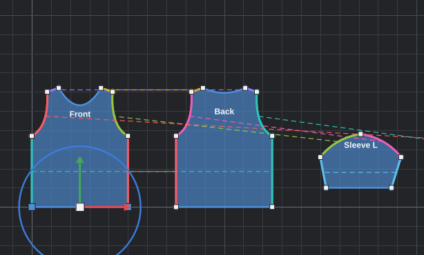

**Transform Points** (**T**) works on points rather than whole pieces.

- **Scale:** with two or more points selected, drag a box to scale them about their middle: red for width,
  green for height, yellow for both. **Q / W / E / R** choose which handles are shown.

- **Select:** click a point; **Ctrl+click** (or Shift+click) adds or removes one; drag a box over empty space
  to select every point inside it, across pieces. **Ctrl+A** selects every point of the active garment.
  Click empty space to clear the selection.
- **Select a whole shape:** double-click inside a piece. This works from the **Select** and **Edit Points**
  tools too, and switches to Transform Points with every point of that piece selected, ready to move, turn
  or scale. **Ctrl+double-click** adds another piece's points to the selection. (In Edit Points, a double-click
  on an edge still adds a point there.)
- **Move:** handles appear in the middle of the selected points. Drag the red arrow to move them left–right
  only, the green arrow up–down only, or the white square to move them freely. You can also just drag any
  selected point. Hold **Shift** on a free drag to keep to one axis.
- **Rotate:** with two or more points selected, drag the blue ring to turn them about their middle. Hold
  **Shift** for 15° steps.
- **Delete** removes the selected points (a piece always keeps at least three). Selecting every point of a
  hole and pressing **Delete** removes the hole.

A curved edge keeps its shape when both of its ends are selected: the curve moves and turns with them. If
only one end is selected, the curve handle stays where it is.

This tool never bends an edge. To curve the edge between two points, switch back to **Edit Points** (**A**)
and drag the edge.

### Cutting holes

A hole is cut in the shape of another piece: draw the shape on top of the piece to cut (with Polygon,
Rectangle or Ellipse, or move an existing piece there), select both (click one, **Ctrl+click** the other), then
right-click and choose **Cut Hole** (also in the **Edit** menu).

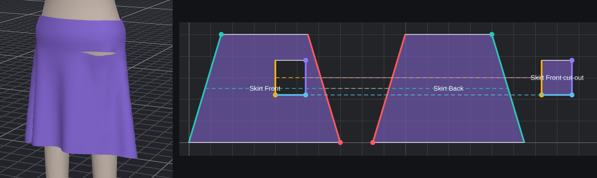

- The piece the other one lies inside gets the hole. The shape must lie entirely inside it, without touching
  its edges or a hole it already has. With several shapes selected inside one piece, each cuts its own hole.
- What was cut out becomes a new piece, **"… cut-out"**, of the same fabric. It is laid out beside the cut
  piece in the pattern and placed in 3D just behind the hole. The piece you drew the shape with is left as it
  is, so either one can become the pocket bag, facing or patch; delete the other if you don't need it.
- A draped piece stays draped when it is cut, and the cut-out starts draped the same way.
- A hole's edges can be sewn like any other edge. For a pocket, sew the cut-out (or the shape you cut with) to
  three sides of the hole and leave the fourth open. The hole runs the opposite way round the shape, so a seam
  between matching edges starts out untwisted.
- **Edit Points** and **Transform Points** work on a hole's points as on the outline's: drag them, add points by
  double-clicking a hole edge, and **Delete** them. A hole needs at least three points, so deleting one of the
  last three removes the hole, and so does selecting all of its points and pressing **Delete**. **Ctrl+Z**
  brings it back.
- In the 2D view you see through a hole to the grid and to any piece beneath it, and a click there selects
  what is underneath.

---

## Sewing

Pick the **Sew** tool (**S**), click one edge, then click the edge to sew it to. The first edge stays
highlighted until you click the second; **Esc** cancels. Both edges must belong to the same garment. An edge
may be sewn to an edge of the same piece (the underarm seam of a sleeve, for example).


Each seam is drawn with:

- the **two sewn edges in the same colour**,
- a **dashed line** joining them (click it to select the seam),
- a **dot on each edge marking the ends that meet**. If the dots are at opposite ends from what you intended,
  the seam is twisted.

Selecting a seam shows it in Properties:


- **From / To** name the two edges and **Lengths** shows how long each is. Edges of different length can be sewn;
  the longer one is eased onto the shorter.
- **Reverse Direction** swaps which ends meet, which fixes a twisted seam.
- **Delete Seam** removes it (so does the **Delete** key).

In the 3D view, seams that are not yet closed appear as red threads between the pieces. They disappear as
simulation pulls each stitch shut.

---

## The 3D view

**Moving around**

| To | Do this |
| --- | --- |
| Orbit | Ctrl+drag with the left mouse button |
| Pan | Shift+drag, or drag with the middle or right button |
| Zoom | Scroll |
| Select a piece | Click it (Ctrl+click adds to the selection). Click empty space to deselect |
| Edit menu | Right-click without dragging |
| Front / side / back | **1** / **3** / **Ctrl+1** (on the number row or the keypad) |
| Orthographic on or off | **5** (number row or keypad), or the **Ortho** button |

### View buttons


| # | Button | What it does |
| --- | --- | --- |
| 1–3 | **Front / Side / Back** | Jump to a standard camera angle. |
| 4 | **Ortho** | Switch between a perspective and an orthographic camera (see below). |
| 5 | **Checker** | Replace fabric colours with a checker texture, to judge UVs and texel density. |
| 6 | **Wire** | Draw the outline of every face, to see the topology. (**View ▸ 3D: Normal Direction**, which has no button, colours the front and back of the faces; see [Normal direction](#normal-direction).) |
| 7 | **Pinch** | Drag the cloth itself to tug it into place (see [Pinching the cloth](#pinching-the-cloth)). |
| 8 | **Gizmo** | Show or hide the move, rotate and scale handles. **Q / W / E / R** choose which of them are shown. |
| 9 | **Avatar** | Show or hide the avatar. Hidden, it still collides with the cloth. |

**Orthographic view.** With **Ortho** on (or **5**, or **View ▸ 3D: Orthographic**) the camera has no
perspective: things further away are not drawn smaller, so the two sides of a garment, or a sleeve and the
body, can be compared by eye. Together with **Front** and **Side** it gives flat, technical-drawing views.
Orbiting, panning, zooming, the handles, Pinch and the Ruler all work the same in both cameras.

### Normal direction

Every face of a piece has a front and a back; its **normal** points out of the front. Game engines and other
3D programs often draw only the front of a face, or light it from that side, so a garment exported with some
pieces facing inwards can show holes or dark patches there.

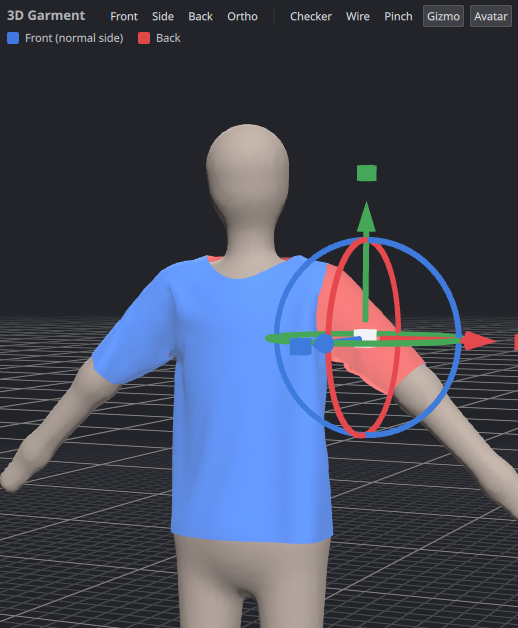

Turn on **View ▸ 3D: Normal Direction** to colour every piece by the side you are looking at: **blue** is the
front, **red** the back. On a finished garment the outside should be blue all over. A piece that shows red
from outside faces the wrong way: select it and press **Invert Normals** under **3D Arrangement** in
Properties (also in the Edit menu and the right-click menu). This turns its faces round without changing its
shape, its drape or the simulation, and it is one undo step. With several pieces selected each one is turned
round, and Properties shows how many of them are inverted. The setting is saved with the project and applies
to every export: OBJ, glTF, FBX and Send to MakeHuman.

### Moving, rotating and scaling pieces

Select one or more pieces and the handles appear at their centre:


- Drag an **arrow** to slide along that axis (red = X, green = Y/up, blue = Z/front).
- Drag a **ring** to rotate about that axis.
- Drag a **box** to scale. The white box in the middle scales evenly: drag up or right to grow, down or left
  to shrink. A coloured box scales along its axis only. Hold **Shift** for steps of a tenth.

Scaling changes the pattern itself, so the piece is the new size in the 2D view too. A coloured box only
changes a piece as far as the piece lies along that axis: on a front panel facing you, red is its width,
green its height, and blue (which points out of the cloth) does nothing. With several pieces selected they
also move apart or together about their shared centre, so a whole garment scales as one. A scaled piece
goes back to its flat arrangement and needs simulating again, and seams keep their edges but the two sides
may no longer be the same length.

### Choosing which handles are shown

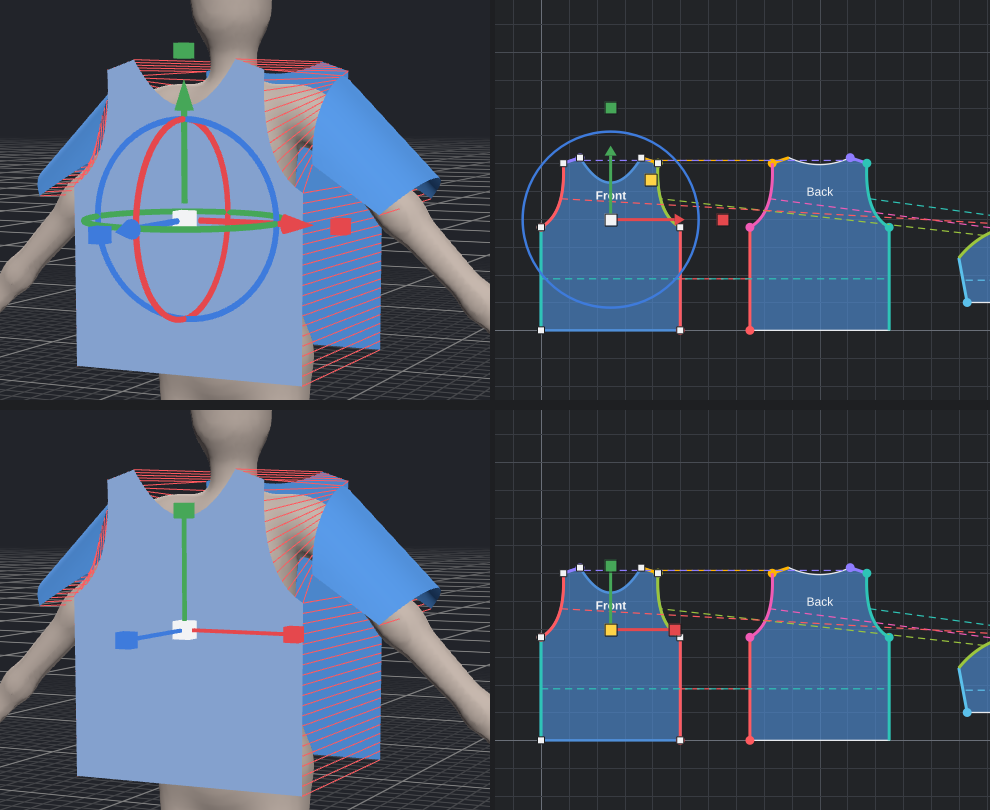

| Key | Handles |
| --- | --- |
| **Q** | Everything: move, rotate and scale |
| **W** | Move only |
| **E** | Rotate only |
| **R** | Scale only |

The keys work in both views and are also under **View ▸ Handles**. The same handles appear in the 2D view:
on the selected pieces with the **Select** tool, and on the selected points with **Transform Points**. In 2D
the yellow box scales evenly and the red and green boxes scale width and height.

A draped piece keeps its draped shape while you move it, and each drag is one undo step. The same values can be
typed under **3D Arrangement** in Properties; typing a value there returns the piece to its flat shape at the
new position. The handles are hidden while a simulation is running.

**Snapping to the grid.** Hold **Shift** while dragging a move arrow and the piece jumps from one grid position
to the next along that arrow's axis, so its position ends on a whole multiple of the snap step (10 cm unless
you change it). Only the axis you drag is snapped; the other two stay where they were. With several pieces
selected, their shared centre is what lands on the grid. The snap step and the size of the ground grid's
squares are set in [Preferences](#preferences).

### Pinching the cloth

When part of a garment has bunched up, caught on the body, or settled a little off, take hold of it and pull.
Turn on **Pinch** in the 3D view (or press **G**), then press on the cloth and drag: the cloth under the cursor
follows your hand, the fabric around it comes along, and the rest of the garment reacts as it would on a real
body.


- **During a simulation**, pinching simply adds your hand to it. Let go and the cloth settles from where you
  left it.
- **After a simulation**, pinching starts the simulation for that garment for as long as you hold on, lets the
  cloth settle for a moment after you let go, and stops again. The whole pinch is one undo step (**Ctrl+Z**).
- The cloth still collides with the avatar and other garments, so you can pull it over a shoulder or smooth it
  down against the body, but not drag it through.
- While Pinch is on, Ctrl+drag orbits the camera, Shift+drag pans, and the move/rotate handles are hidden. Turn
  Pinch off to get them back.
- About 5 cm of cloth around the cursor is held; cloth further away is moved only by the fabric pulling on it.
- Only garments that are being simulated can be pinched. If another garment is the active one and a simulation
  is already running, stop it first or tick **All garments**.

### Pinning the cloth

Pins hold vertices still while the rest of the garment simulates, which is handy for keeping a hem, a strap or
a neckline where you want it. Turn on **Pin** in the 3D view (or **View ▸ 3D: Pin Vertices**); wireframe
turns on with it so you can see the vertices, and turns off again when you leave Pin mode. Then:

- **Click** a piece of cloth to select the nearest vertex; the selection is shown in yellow.
- **Drag a box** anywhere in the 3D view, including empty space around the garment, to select every visible
  vertex inside it on the pieces facing you. A plain click or box replaces the selection; hold **Shift** while
  clicking or dragging a box to add to it (**Ctrl-click** also adds, or removes an already-selected vertex).
- **Right-click** the cloth to open the Pin menu: **Pin Selected Vertices**, **Unpin Selected Vertices**,
  **Clear Vertex Selection**, and **Unpin All on Selected Garments**. Pinned vertices are marked in orange.
- **Unpin All** (also in the **Simulation** menu) clears every pin on the selected garments. With nothing
  selected it uses the garment you last clicked in the 3D view.

Pins are applied when the solver starts, so they freeze the cloth from the beginning of the next run. To pin
after a simulation, let it stop (or stop it), select vertices on the draped cloth, pin them, and simulate
again: the pinned vertices stay where they are while the rest settles. Each pin or unpin is one undo step.

Pins are saved with the project. Changing a piece's shape or the garment's particle distance rebuilds its
mesh, which makes the old vertex numbers meaningless, so those edits remove the piece's pins.

---

## Simulation

**Simulate** (Space) runs in two phases, automatically:

1. **Sewing.** Stitched edges are drawn together at a steady pace. Gravity is held back so the pieces do not
   fall off the avatar before they are attached.
2. **Draping.** Once the seams are closed, gravity acts and the cloth settles. It keeps simulating until you
   press **Simulate** again.

The status bar shows the particle count and the time per step while it runs.

### Which garments are simulated

Only the **active garment** — the one selected in Layers — moves. Every other garment stays exactly as it is
and acts as an obstacle. Two ways to widen that:

- Click the **⇄** button on a garment's row in Layers. That garment is then simulated as well whenever another
  garment is the active one.
- Tick **All garments** next to the Simulate button to simulate every visible garment at once.

### Layering garments


Cloth collides with the avatar, with itself and with other garments. To put one garment over another, simulate
the inner one first (the skirt), then select the outer one (the shirt) and simulate it: the skirt stays put and
the shirt drapes over it. Simulating both together also works when the outer garment starts further from the
body, as the built-in garments do.

### Simulation settings

At the bottom of the Properties panel, under **Simulation**:

| Setting | Meaning |
| --- | --- |
| **Also simulate with other garments** | The same as the ⇄ button in Layers. |
| **Gravity** | Downward acceleration in m/s². |
| **Substeps** | Solver steps per frame. More is stiffer and more accurate, and slower. |
| **Speed** | Slow motion or fast forward. |
| **Cloth-to-cloth collision** | Keeps cloth from passing through itself and other garments. Turning it off roughly halves simulation time. |
| **Ground plane** | Whether cloth stops at the floor. |

### Good to know

- Editing anything while simulating stops the simulation first.
- Changing a piece's outline, its seams or its particle distance returns it to its flat arrangement, because the
  mesh has changed. Simulate again to re-drape.
- A garment that is too small for the body cannot close all its seams; simulation gives up on those after a
  moment and drapes the rest.

---

## Layers


The panel lists garments (◆), the groups inside them (▣) and pieces (coloured squares, in the piece's fabric
colour).

| To | Do this |
| --- | --- |
| Select | Click a row. Clicking a garment or group selects all its pieces. Ctrl+click adds pieces |
| Make a garment active | Click it or any of its pieces |
| Rename | Double-click the name, or right-click ▸ **Rename**. Type the new name and press **Enter** or click elsewhere to keep it; **Escape** cancels |
| Hide or show | Click the circle at the right of the row. Hidden garments are neither simulated nor exported |
| Fold a garment or group | Click the arrow at the left |
| Group pieces | Select them, then **Ctrl+G** or right-click ▸ **Group Selected Pieces** |
| Move into a group | Drag the row (or its **⋮⋮** handle) onto the middle of a group, or onto a garment for its top level. Or right-click ▸ **Move to Group**. Groups can be nested |
| Reorder | Drag the row onto the top or bottom edge of another row; a line shows where it will go. Works across groups and garments. Dragging one of several selected pieces (or using **Move to Group** on it) moves them all, side by side and in their current order |
| Ungroup | Right-click the group ▸ **Ungroup**; its contents move up one level |
| Link for simulation | The **⇄** button on a garment row (see [Simulation](#which-garments-are-simulated)) |
| Add | **+ Garment** and **+ Group** at the bottom |
| Delete | **Delete** at the bottom, the Delete key, or right-click ▸ **Delete** |

Each garment row also shows its face count.

---

## Properties

The panel shows sections for the current selection. Click a section title to fold it. Sliders and number boxes
apply immediately; dragging a slider counts as a single undo step.

### 3D Arrangement and Fabric Physics


**3D Arrangement** — where the flat piece starts before simulation.

| Setting | Meaning |
| --- | --- |
| **Position X / Y / Z** | Centre of the piece in metres. X is left–right, Y is up, Z is front–back (positive is in front of the avatar). |
| **Rotation X / Y / Z** | Orientation in degrees. A back piece is typically rotated 180° about Y so it faces away. |
| **Wrap** | Curls the piece around its vertical axis by this many degrees, for sleeves and trouser legs. |
| **Normals** | Which way the piece's faces point: *As drawn*, *Inverted*, or how many of the selected pieces are inverted. |
| **Invert Normals** | Turns the faces of the selected pieces round (see [Normal direction](#normal-direction)). |

**Fabric Physics** — per piece, so one garment can mix fabrics.

| Setting | Meaning |
| --- | --- |
| **Preset** | Cotton, Silk, Jersey Knit, Denim, Leather, Wool or Chiffon. Changing any slider afterwards shows *Custom*. |
| **Weight** | Grams per square metre. Heavier cloth hangs straighter. |
| **Stretch** | Resistance to stretching along the weave (0–100). |
| **Shear** | Resistance to diagonal distortion (0–100). |
| **Bend** | Resistance to folding. Low values give many small wrinkles; high values give stiff, smooth cloth. |
| **Damping** | How quickly motion dies out. |
| **Friction** | Grip against the avatar and other cloth. |
| **Thickness** | Collision thickness in millimetres: how far the cloth sits off the body and other layers. The 3D view shows the fabric as a solid shell. A garment-wide thickness overrides it. |

With several pieces selected, a change applies to all of them.

---

## Topology: face count, triangles and quads


- **Particle distance** is the target edge length of the mesh, per garment. Smaller means more faces: finer
  wrinkles and slower simulation. The face and vertex counts update as you drag.
- **Faces** chooses **Triangles** (even, near-equilateral) or **Quads** (a grid along the fabric grain).
- **Piece override** gives the selected piece its own particle distance; 0 means "use the garment's".

**Garment Thickness** — tick **Use one thickness for the whole garment** to give every piece in the active
garment the same collision thickness. The slider is in centimetres. This overrides the per-piece **Thickness**
under Fabric Physics for that garment only, so a shirt can be 1 cm and a skirt 2 cm. The 3D view extrudes the
surface into a closed shell at that thickness; the slider updates it immediately.


Turn on **Wire** in the 3D view to see the result. Quad topology is quad-dominant: the grid fills each piece
and a few triangles remain where the outline is curved or slanted. The panel shows how many of each. Quads are
written to OBJ and FBX; glTF and MakeHuman always receive triangles, because those formats require it.

Sewn edges always get the same number of segments on both sides, so seams line up vertex for vertex.

---

## Materials, UVs and texel density


### Material

Each piece uses one material; pieces can share one.

| Setting | Meaning |
| --- | --- |
| Drop-down | Assign another existing material to the selected pieces. |
| **New** | Give the selected pieces their own copy of the current material. |
| **Name** | Used for the material in exported files. |
| **Colour** | Click the swatch to pick a colour. |
| **Texture** | **…** chooses an image (PNG, JPEG, WebP, BMP); **✕** removes it. |
| **Texture repeat** | How many times the image tiles across the UV square. |
| **Roughness / Metallic / Opacity** | Surface appearance, also written to glTF and FBX. |

A note under the sliders tells you when a material is shared, since changes then affect every piece using it.

### UVs

UVs come from the 2D pattern: the garment's layout is scaled evenly into the unit square, so every piece gets
the same texel density and the fabric grain follows the pattern.

Press **U** (or the **Pattern** button) to see the UV layout of the active garment, and switch on **Checker**
in the 3D view to see how a texture will sit on the cloth:


- In the UV layout, drag a piece to move it in texture space.
- **UV scale** and **UV rotation** in Properties adjust the selected piece about its centre.
- **Texel density** reports texture pixels per centimetre of fabric for the selected piece, for the texture
  size set in Preferences. The UV view shows the same figure on every piece.

---

## Avatars

The **Avatar** menu chooses what garments are draped on:

| Choice                    | Use it for                                                                                                                                    |
| ------------------------- | --------------------------------------------------------------------------------------------------------------------------------------------- |
| **Mannequin**             | The built-in figure, about 1.67 m tall. It has the proportions of the MakeHuman base mesh.                                                    |
| **MakeHuman Base Mesh**   | Making clothes for MakeHuman characters. Requires the base mesh to be linked in Preferences. Starts as MakeHuman's neutral default character. |
| **MakeHuman Body Shape…** | Change that character's gender, age, muscle, weight, height and proportions (see below).                                                      |
| **Load OBJ…**             | Your own character. The OBJ must be in metres, Y up, facing +Z; it is stood on the ground automatically.                                      |
| **None**                  | Simulating cloth with nothing to collide with but the ground.                                                                                 |

Loading an avatar takes a second or two while its collision data is prepared. If you press Simulate during
that time, simulation starts as soon as the avatar is ready.

### MakeHuman body shape

With the MakeHuman avatar selected, **Avatar ▸ MakeHuman Body Shape…** opens the same sliders as the *Main*
tab of MakeHuman's Modelling page:


Every slider at 50 % is MakeHuman's default character, and the body matches what MakeHuman shows for the same
values (the default is 165.9 cm tall in both). The avatar is rebuilt when you let go of a slider. The dialog can
stay open while you work, and the settings are saved with the project.


- Garments that are already draped keep their shape when the body changes. Simulate again to fit them.
- The built-in garments are placed at the shoulders, arms and hips of whatever body is current when you add
  them. They are one size, cut for an average adult: on a much larger, smaller or heavier body, resize the
  pattern pieces.
- The sliders need MakeHuman's `data/targets` folder next to the base mesh's `data/3dobjs` folder, which is
  where a normal MakeHuman installation keeps it. Without it the avatar is the unmodified base mesh file,
  which is MakeHuman's average woman.
- Ethnicity is fixed at MakeHuman's default even mix, and the detail sliders on MakeHuman's other tabs (face,
  torso, arms and legs, breast shape) are not available here.

---

## Saving and the project file

**File ▸ Save** (Ctrl+S) and **Save As** (Ctrl+Shift+S) write a `.garment.json` file containing every
garment, seam, material, the avatar choice, simulation settings, and the draped shape. **File ▸ Open Recent**
lists the last ten projects. A dot in the window title marks unsaved changes.

The file is plain JSON meant to be readable and editable by hand:

```json
{
  "format": "seamstress-garment",
  "garments": [
    { "name": "Scarf",
      "particleDistance": 2,
      "topology": "triangles",
      "pieces": [
        { "name": "Strip",
          "points": [ { "at": [0, 0] }, { "at": [120, 0] }, { "at": [120, 20] }, { "at": [0, 20], "curve": [-5, 10] } ] }
      ] }
  ]
}
```

- Pattern lengths are centimetres; 3D positions are metres; angles are degrees.
- `curve` is the control point that bends the edge leaving that point.
- A seam's `edge` number *n* means the edge that starts at point *n* of the piece, counting from 0.
- `holes` lists a piece's holes, each written like `points` and running clockwise. Their points are numbered on
  from the outline's: with four outline points, the first hole's first point (and the edge leaving it) is 4.
- Anything left out takes its default, so a minimal file like the one above loads.
- The `drape` block holds the simulated shape. Deleting it returns the piece to its flat arrangement.
- Texture paths are stored relative to the project file when the image is in the same folder or below it.

A complete example is in [`samples/tshirt-and-skirt.garment.json`](../samples/tshirt-and-skirt.garment.json).

---

## Exporting

**File ▸ Export** offers three formats. Each first asks two questions:


- **Export**: all visible garments, or only the active one.
- **Weld sewn seams**: merge the stitched vertices so each garment is one connected mesh. Only seams that
  simulation has actually closed are merged, so an unsimulated garment exports as separate flat pieces.

| Format | Notes |
| --- | --- |
| **Wavefront OBJ** | `.obj` plus `.mtl`. One object per garment, one group per piece. Keeps quads. |
| **glTF 2.0** | `.glb` (single file, textures embedded) or `.gltf` + `.bin`, chosen by the file name. Triangles only. |
| **FBX** | Binary FBX 7.4. Geometry, normals, UVs and materials; no skeleton or animation. Keeps quads. |

All formats export the garment as it currently looks in the 3D view, with Y up. OBJ and glTF are in metres; FBX
is in centimetres, which is that format's convention, so it imports at the right size. Textures are copied next
to the exported file (or embedded, for `.glb`). Hidden garments and pieces are left out.

---

## Send to MakeHuman

Seamstress can write a garment directly into MakeHuman's clothes library, fitted so that it follows the
character when its body shape changes.

1. Link MakeHuman once in [Preferences](#preferences).
2. Choose **Avatar ▸ MakeHuman Base Mesh**, and optionally set its body with **MakeHuman Body Shape…**.
3. Build the garment and simulate it on that avatar.
4. Select the garment and choose **File ▸ Export ▸ Send to MakeHuman**.
5. Check the **Asset name** (it starts as the garment's name) and press **Send**.

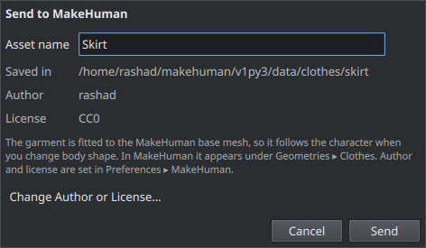

The asset name is what MakeHuman lists the garment under. The folder and files are named after it, with
spaces and other characters that are awkward in file names replaced by `_`, so *Summer Skirt* is written as
`summer_skirt.mhclo`, `summer_skirt.obj` and `summer_skirt.mhmat` (plus the texture, if any) in
`<MakeHuman user folder>/data/clothes/summer_skirt/`. The dialog shows that folder as you type, and warns
when an asset of that name is already there: sending replaces it, while a different name keeps both. In
MakeHuman the garment appears under **Geometries ▸ Clothes**; restart MakeHuman if it was already running.

Every asset carries the **author** and **license** set in **Preferences ▸ MakeHuman**, and MakeHuman shows
them in its clothes library. The files load in MakeHuman 1.2, 1.3 and the current development version, and in
MakeHuman 2 (which shows the author but not the license).

Seamstress refuses to send while a different avatar is in use, because the garment would not be fitted to
MakeHuman's body.

---

## Preferences

**File ▸ Preferences…** (**Ctrl+,**). The settings are grouped into pages, listed down the left side.


| Page | Setting | Meaning |
| --- | --- | --- |
| General | **Interface language** | English, Español, Português (Brasil), Français, 中文（简体） or 日本語. See [Language](#language) below. |
| General | **Measurements** | *Metric* shows centimetres, metres, millimetres and g/m². *Imperial* shows inches, oz/yd² and feet and inches for the avatar height, and the grids change to 4 in squares with a stronger line every foot. Only the interface changes: garment files and exports are the same either way. |
| General | **Session Logs** | Show where logs are written and open the folder. A log is kept for every session. See [Logs](#logs) below. |
| Themes | **Preset** | The colour scheme of the whole interface: *Default* (the dark grey Seamstress has always used), *Light*, *High Contrast Dark* or *High Contrast Light*. See [Themes](#themes) below. |
| Themes | **Save Theme… / Load Theme…** | Save the current colours to a file, or load a theme file. A loaded theme is remembered as *Custom*. |
| Viewport | **Renderer** | *Automatic* uses the GPU and falls back to CPU rendering when no GPU driver is found or the GPU failed to start last time. *GPU* and *CPU* force one or the other. Takes effect on the next start. |
| Viewport | **Grid size** | The size of one square of the ground grid in the 3D view. 10 cm by default, 4 in with imperial units. |
| Viewport | **Snap step** | The step a piece snaps to when you hold Shift while dragging a move arrow in the 3D view. Starts the same as the grid size; set it smaller for finer steps. |
| MakeHuman | **User data folder** | MakeHuman's own data folder, the one containing `data/clothes` (for example `~/makehuman/v1py3`). |
| MakeHuman | **Base mesh** | MakeHuman's `base.obj`, found in its `data/3dobjs` folder. |
| MakeHuman | **Launch command** | Optional. If set, MakeHuman is started after *Send to MakeHuman* when it is not already running. |
| MakeHuman | **Author name** | Written into every asset sent to MakeHuman. Left empty, your login name is used. |
| MakeHuman | **License** | The license written into every asset sent: pick *CC0* (anyone may use it freely), *CC-BY* (credit required), *CC-BY-SA*, *CC-BY-NC*, *CC-BY-ND* or *AGPL3*, or type any other. |
| MakeHuman | **Detect Automatically** | Looks for MakeHuman in the usual places and fills in the two paths. |
| Textures | **Texture size for texel density** | The texture resolution assumed by the texel density read-outs. |
| Keyboard | Every shortcut | See [Keyboard shortcuts](#keyboard-shortcuts) below. |

Everything except the theme waits for **Save**; **Cancel** leaves it all as it was (a previewed theme is
switched back too). The renderer in use is shown in the bottom-right corner of the 3D view. You can also
force it for one run by starting Seamstress with `--cpu` or `--gpu`.

### Logs

Seamstress keeps a plain-text log of every session to help diagnose problems; there is no setting to turn it
off. *Preferences ▸ General ▸ Session Logs* shows the log folder and opens it.

Every launch writes a new plain-text file named after the date and time, such as
`seamstress-2026-10-23_14-30-05.txt`, into the `logs` folder inside Seamstress's own folder:

- Windows: `Documents\Seamstress\logs`
- Linux: `~/.config/Seamstress/logs` (or `$XDG_CONFIG_HOME/Seamstress/logs`)
- Flatpak: `~/.var/app/io.github.mangodragonhub.Seamstress/config/Seamstress/logs`

The log records the version, operating system, renderer choice, files opened, and errors with their stack
traces. It stays on your computer and is not sent anywhere. If Seamstress does not start, or behaves strangely,
the newest log is the first thing to look at, and attaching it to a bug report helps a great deal. **Open Logs
Folder** in Preferences shows the files.

### Themes

**Preferences ▸ Themes** changes the colours of the whole interface — windows, panels, both views, the grid,
annotations and the 3D background — and remembers the choice for the next start.

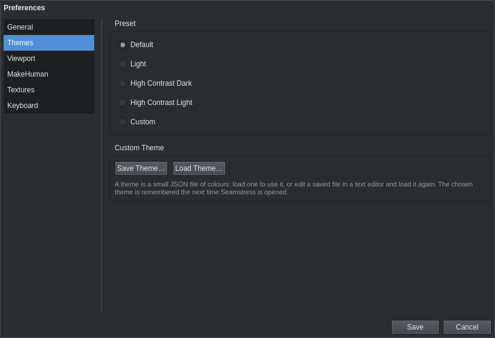

- **Default** is the dark grey scheme Seamstress has always used. **Light** is for bright rooms.
- **High Contrast Dark** and **High Contrast Light** push the colours apart for easier reading, in
  particular between text, edges, the grid and the annotations.
- Picking a preset previews it at once; **Save** keeps it, **Cancel** puts the old theme back.
- **Save Theme…** writes the current colours to a small JSON file: a `name` and a `colors` map with one
  `"#rrggbb"` value per role. **Load Theme…** applies such a file and remembers it as the **Custom**
  theme. The file is plain text, so it is an easy starting point for your own theme: save one, edit the
  colours in any text editor, and load it again. Roles you leave out fall back to the Default colours.

### Language

**Preferences ▸ General ▸ Interface language** switches every menu, panel, dialog, tooltip and status message
between English, Spanish, Brazilian Portuguese, French, Simplified Chinese and Japanese. The change happens as
soon as you press **Save**; there is no need to restart.

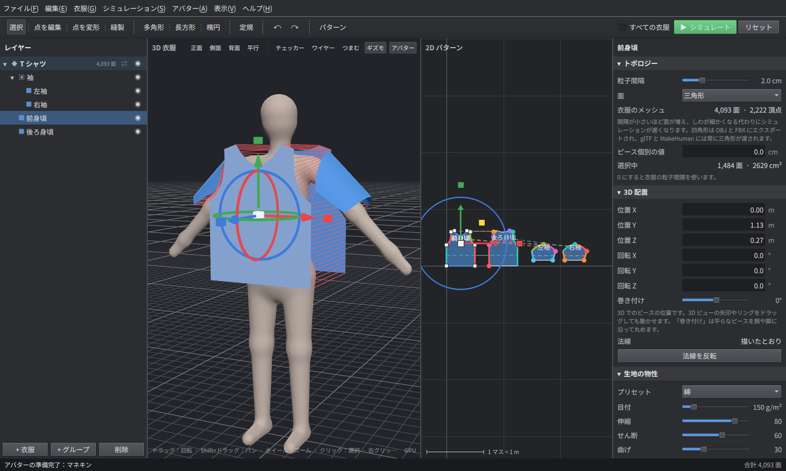

- **Names you see in the layers panel are part of your project**, so they are not translated after the fact.
  Garments, pieces, groups and materials you add *after* switching get names in the new language (a T-shirt
  added in French has the pieces *Devant*, *Dos*, *Manche G* and *Manche D*); everything that already exists
  keeps its name. Rename anything by double-clicking it.
- Fabric presets (Cotton, Silk, …) are shown in your language but saved under their English names, so a
  project opens the same way whatever language it is opened in.
- Undo history entries keep the language they were made in.
- Keys, units and file formats do not change with the language, and neither do MakeHuman's own panel names
  (*Geometries ▸ Clothes*), which are quoted as MakeHuman shows them.
- The file dialogs and colour picker come from Qt and your desktop, and follow your system language rather than
  this setting.

To try a language for one run without changing the saved choice, start Seamstress with `--lang es` (or `pt`,
`fr`, `zh`, `ja`, `en`).

### Keyboard shortcuts

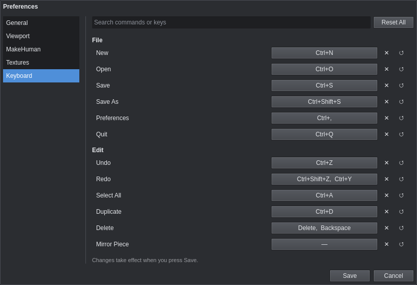

The **Keyboard** page lists every command that can have a key, grouped like the menus: files, editing, tools,
handles, view and simulation, including commands that have no key to begin with (such as **Mirror Piece** or
**3D: Wireframe**).

- **To change a key**, click the button showing it, then press the new key with any of Ctrl, Alt, Shift or
  Meta. **Escape** stops listening without changing anything.
- **✕** leaves the command without a key. **↺** puts back its default, and **Reset All** puts back every
  default.
- **Search** finds a command by name or by key: type `ctrl+d` to see what Ctrl+D does.
- A key given to two commands turns red and is listed under the table. Such a key does nothing until one of
  the two is changed, so fix it before saving.

The new keys work as soon as you press **Save**, and the menus, tooltips and right-click menu show them.
They are kept in Seamstress's settings file (`~/.config/Seamstress/settings.json` on Linux), which stores only
the keys you changed. Keys without Ctrl, Alt or Meta are ignored while you type in a text box, so typing a
name never switches tools.

---

## Keyboard and mouse reference

### Keys

These are the defaults. All of them can be changed under [Preferences ▸ Keyboard](#keyboard-shortcuts).

| Key | Action |
| --- | --- |
| V / A / T / S | Select / Edit Points / Transform Points / Sew |
| Q / W / E / R | Handles: all / move only / rotate only / scale only (both views) |
| P / B / O | Polygon / Rectangle / Ellipse |
| M | Ruler |
| U | Switch the 2D view between pattern and UV layout |
| F | Frame everything in the 2D view |
| 1 / 3 / Ctrl+1 | 3D view from the front / side / back (number row or keypad) |
| 5 | Orthographic 3D view on or off (number row or keypad) |
| G | Turn Pinch on or off in the 3D view |
| Space | Start or stop simulation |
| Enter | Finish the polygon being drawn |
| Esc | Cancel the current tool action |
| Delete / Backspace | Delete the selected pieces, seam or point |
| Ctrl+Z | Undo |
| Ctrl+Shift+Z or Ctrl+Y | Redo |
| Ctrl+D | Duplicate the selected pieces |
| Ctrl+G | Group the selected pieces |
| Ctrl+A | Select every piece of the active garment |
| Ctrl+N / Ctrl+O | New project / open |
| Ctrl+S / Ctrl+Shift+S | Save / save as |
| Ctrl+, | Preferences |
| Ctrl+Q | Quit |

### Mouse

| | 2D view | 3D view |
| --- | --- | --- |
| Left button | The current tool | Click to select; drag a handle to move or rotate; with Pinch on, drag the cloth to pull it |
| Ctrl + drag | — | Orbit around the avatar |
| Ctrl or Shift + click | Add to the selection | Add to the selection |
| Shift while drawing | Square, circle, or a snapped polygon side | — |
| Shift + drag | — | Pan |
| Shift + drag a move arrow | — | Snap the piece to the grid along that axis |
| Shift + drag a point (Edit Points) | Snap the point to the grid | — |
| Middle or right drag | Pan | Pan |
| Right-click | Edit menu | Edit menu |
| Alt + left drag | Pan | — |
| Scroll | Zoom about the cursor | Zoom |
| Double-click | Finish a polygon; add a point on an edge (Edit Points); select every point of a piece | — |
| Drag (Ruler) | Measure; the ends catch on pattern points | Click or drag between two points on the cloth or avatar |
| Drag on empty space (Transform Points) | Box-select points | — |

---

## Troubleshooting

**A seam twists the cloth into a knot.** The two edges are sewn end-to-wrong-end. Select the seam (click its
dashed line with the Select tool) and press **Reverse Direction**. The dots on the two edges show which ends
meet.

**The pieces fall off or end up on the wrong side of the body.** Check the 3D arrangement before simulating:
a front piece should stand in front of the avatar and a back piece behind it, facing away (rotated 180° about
Y). Sleeves need **Wrap** so they start curled around the arm. Press **Reset**, move the pieces with the
handles, and simulate again.

**Some seams never close.** The garment is too small to go around the body there. Widen the pieces, or check
that an arm or leg is not caught between two pieces that are meant to meet.

**The cloth is bunched up or caught somewhere after simulating.** Turn on **Pinch** (**G**) in the 3D view and
drag that part of the cloth to where it should sit.

**Simulation is slow.** Raise **Particle distance** (fewer faces), lower **Substeps**, or switch off
**Cloth-to-cloth collision** while blocking out the garment and turn it back on for the final drape.

**One garment hangs through another.** Simulate the inner garment first, then the outer one, with
**Cloth-to-cloth collision** on. Two loose hems at the same height can still slip past each other.

**A texture shows as missing.** The image file was moved. Choose it again with **…** in the Material section.

**The 3D view is blank or the application will not start.** Start it with `--cpu` to use CPU rendering, or
choose *CPU* under **Preferences ▸ Viewport ▸ Renderer**. If that does not help, open the newest file in the
[logs folder](#logs): it records the startup details and any error, and is the best thing to attach to a bug
report.

---

*The screenshots in this guide were taken from the application itself. `docs/tools/annotate.py` crops and
numbers them; see the comments at the top of that file.*
